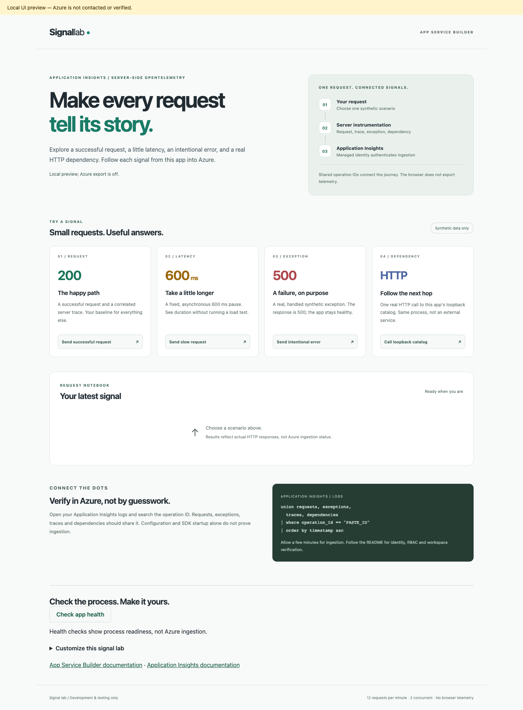
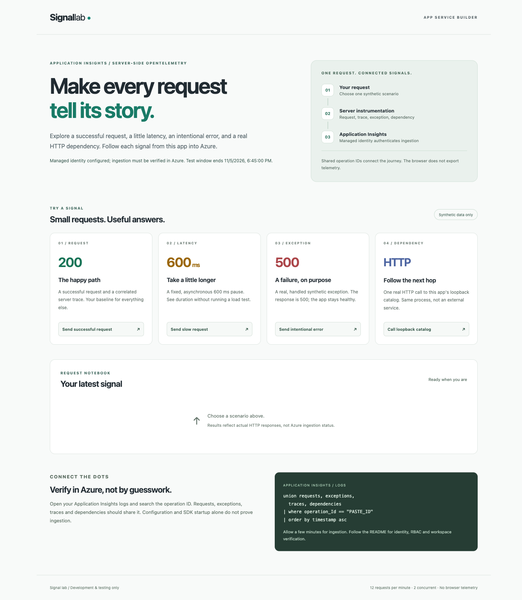
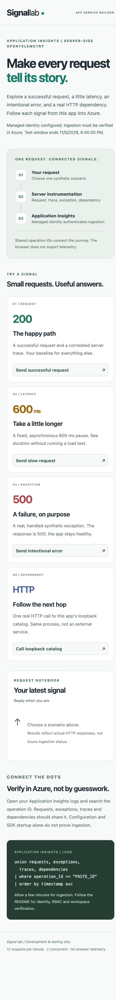

# Trace a request from App Service Builder into Application Insights

Deploy a small ASP.NET Core signal lab and follow real server-side requests,
traces, a handled exception and an HTTP dependency into Application Insights.
You will configure managed-identity ingestion, generate a few synthetic
requests, and verify their shared operation IDs.

App Service Builder is a development/test preview. This sample uses .NET 10,
server-side OpenTelemetry and explicit system-assigned managed identity.
The CLI-first procedure deploys a local ZIP; a GitHub App installation is not
required for ZIP source. Local tests do not establish hosted ingestion.

## Prerequisites

- Access to the [App Service Builder Portal](https://builder.appservice.azure.com/)
  and an approved Azure subscription in **West US 2** (`westus2`).
- Permission to create a dedicated resource group, Log Analytics workspace,
  Application Insights component and Builder app, and to assign **Monitoring
  Metrics Publisher** at the Application Insights resource scope. The operator
  needs role-assignment authority separately from resource creation.
- [Builder CLI](https://builder.appservice.azure.com/docs/reference/cli/) version
  **0.0.2 or later**, including `app deploy --source-archive` and `--manifest`.
  Verify these options with `builder app deploy --help` before starting.
- Azure CLI and Bicep for the dedicated resources. For optional local checks:
  Git, stable .NET 10 SDK `10.0.100` or later stable .NET 10 feature band, and
  port 8080 available. Do not use a preview SDK.
- Permission to query your new workspace, such as **Log Analytics Reader**.
  App ingestion permission does not grant the operator query access.
- Public outbound HTTPS connectivity from Builder to Azure Monitor and its
  managed-identity endpoint. Stop if policy requires private endpoints rather
  than changing another application's network settings.

The sample has one web process and no database, browser telemetry, secrets,
external assets or external dependency service. Anyone who can reach the
public app can use the demonstration controls. Each process allows two
concurrent operations and twelve operations/minute. These are not distributed
quotas or a guaranteed cost cap.

## 1. Get the sample and run the signal lab locally

```bash
git clone https://github.com/AzureAppService/app-service-builder-application-insights.git
cd app-service-builder-application-insights
```

From this sample's root:

```bash
dotnet restore tests/Sample.Tests.csproj --configfile NuGet.Config --locked-mode
dotnet test tests/Sample.Tests.csproj --no-restore
dotnet publish BuilderApplicationInsightsSample.csproj --no-restore \
  -c Release -o bin/sample-publish
dotnet bin/sample-publish/BuilderApplicationInsightsSample.dll
```

If the public NuGet v3 endpoint is unreachable, the official v2 endpoint is an
alternative for restore:

```bash
dotnet restore tests/Sample.Tests.csproj \
  --source https://www.nuget.org/api/v2/ --locked-mode
```

Open `http://localhost:8080/`. The banner explicitly says Azure export is off.
Local requests still create OpenTelemetry activities, but do not send them to
Azure. Tests use in-memory collectors and capture real Azure exporter envelopes
with a synthetic credential and an in-process HTTP transport. No test sends
data to Azure or proves hosted managed-identity authentication.
Stop the app with Ctrl+C before running tests, which bind port 8080.

| Control            | Actual behavior                                                |
| ------------------ | -------------------------------------------------------------- |
| Successful request | HTTP 200 and a correlated synthetic server trace               |
| Slow request       | HTTP 200 after a fixed 600 ms asynchronous delay               |
| Intentional error  | HTTP 500 with a real, deliberately handled synthetic exception |
| Loopback catalog   | HTTP 200 after one actual HttpClient call to the same process  |

The dependency is a fixed `http://127.0.0.1:8080/internal/catalog` call.
It is a real HTTP dependency, **not an external Azure service**. No URL input
or redirect is accepted. The catalog accepts loopback connections only.
`/health` returns `OK` and proves process readiness
only. Unknown routes return 404. Demo POSTs reject body/query input with 400.
Excess traffic returns explicit 429 and Retry-After.

The dashboard below is a **local preview with Azure export off**, not hosted
ingestion evidence.



The page lives at `/`. **Check app health** displays the actual `/health` response
without leaving the lab or downloading a text file; it checks process readiness,
not ingestion. Expand **Customize this signal lab** for the relevant source files.
The links name App Service Builder and Application Insights documentation separately.

## 2. Provision the app, identity and dedicated monitoring

Choose a fresh descriptive test group and names in your confirmed subscription.
These commands create billable Azure resources; review their scope and prices
before executing.

```bash
SUBSCRIPTION="<confirmed-subscription-id>"
TENANT="<confirmed-tenant-id>"
LOCATION="westus2"
RG="rg-builder-appinsights-demo"
WORKSPACE="law-builder-appinsights-demo"
APPINSIGHTS="appi-builder-appinsights-demo"
APP_NAME="builder-appinsights-demo"
# Choose your own future UTC time, approximately two hours ahead.
EXPIRES_AT="<yyyy-MM-ddTHH:mm:ssZ>"

az login --tenant "$TENANT"
az group create --subscription "$SUBSCRIPTION" \
  --name "$RG" --location "$LOCATION"
az deployment group what-if --subscription "$SUBSCRIPTION" \
  --resource-group "$RG" --name appinsights-monitoring \
  --template-file infra/sample.bicep \
  --parameters appName="$APP_NAME" workspaceName="$WORKSPACE" \
    applicationInsightsName="$APPINSIGHTS" expiresAt="$EXPIRES_AT"
```

Review that only your new app, workspace, component, visitor-access policy and
destination-scoped publisher assignment are created, then provision:

```bash
az deployment group create --subscription "$SUBSCRIPTION" \
  --resource-group "$RG" --name appinsights-monitoring \
  --template-file infra/sample.bicep \
  --parameters appName="$APP_NAME" workspaceName="$WORKSPACE" \
    applicationInsightsName="$APPINSIGHTS" expiresAt="$EXPIRES_AT"

APPINSIGHTS_ID="/subscriptions/$SUBSCRIPTION/resourceGroups/$RG/providers/Microsoft.Insights/components/$APPINSIGHTS"
WORKSPACE_ID="/subscriptions/$SUBSCRIPTION/resourceGroups/$RG/providers/Microsoft.OperationalInsights/workspaces/$WORKSPACE"
APP_PRINCIPAL_ID=$(az deployment group show --subscription "$SUBSCRIPTION" \
  --resource-group "$RG" --name appinsights-monitoring \
  --query properties.outputs.appPrincipalId.value -o tsv)
```

The component is workspace-based with **local authentication disabled**.
It accepts only authenticated ingestion; an instrumentation key or connection
string alone cannot authorize telemetry. The workspace uses PerGB2018,
30-day retention and a 0.1 GB/day ingestion cap.

Monitor [Azure Monitor pricing](https://azure.microsoft.com/pricing/details/monitor/)
and Builder's compute charges. Daily caps can overshoot and are not hard dollar
limits. Min-zero scaling reduces idle compute, not all retained-resource cost.
Use a two-hour absolute demonstration deadline; retain the app for review
until you explicitly decide to clean up.

`infra/sample.bicep` imports the monitoring module and creates the app
**without source or running compute**. It configures system-assigned identity,
minimum replicas 0/maximum 1, the three variables and resource-scoped publisher
role before the first ZIP deployment. It deliberately disables **visitor
authentication** for these public, synthetic controls. This does not disable
authenticated Application Insights ingestion or Azure RBAC for management.
The monitoring module passes the connection string through a secure output,
so app configuration waits for the component and does not expose that value
in deployment history.
Review this public-access choice before provisioning; do not apply this
template over an existing app or shared resources.

The preview Builder resource may emit Bicep `BCP081` warnings because its type
schema is not distributed with the compiler. Compilation is not proof of
provider availability; review what-if and the actual provider response.

## 3. Verify identity and deployment configuration

Open the new app in Builder Portal. Confirm **Identity** is system-assigned,
**Scaling** is minimum 0/maximum 1, and visitor **Access** matches your deliberate
public-demo choice. Record its principal ID and compare it to the publisher
role assignment in task 5. Role propagation may take a few minutes.

The root manifest selects `dotnet`, version `"10"`, standard publish, startup
`dotnet BuilderApplicationInsightsSample.dll`, port 8080 and health `/health`.
It does not contain identity, variables or Application Insights settings.
No App Service autoinstrumentation flag is required or implied.

Although named “Metrics Publisher,” this role authorizes Application Insights
telemetry ingestion. Do not substitute Owner or Contributor for the app's role,
or grant it subscription-wide access.

## 4. Enable server-side telemetry and deploy

The template references the new component's connection string server-side,
without outputting it. Confirm the following variable names in Builder
**Variables**. Do not put their values in Git, browser code, chat or screenshots.

| Variable                                | Value                                                                |
| --------------------------------------- | -------------------------------------------------------------------- |
| `TELEMETRY_MODE`                        | `managed-identity`                                                   |
| `APPLICATIONINSIGHTS_CONNECTION_STRING` | Connection string from your new component                            |
| `SAMPLE_EXPIRES_AT`                     | Your own future UTC deadline, format `yyyy-MM-ddTHH:mm:ssZ`          |
| `AZURE_CLIENT_ID`                       | Leave unset; this sample explicitly selects system-assigned identity |

Use a deadline about two hours ahead. After it passes, demo POSTs return 410
while the dashboard stays readable. Redeploying/restarting does not extend the
absolute deadline. Any extension should be intentional.

Sign in to the intended Azure tenant and select that subscription in the
Builder CLI's account flow:

```bash
builder login --help
builder login --tenant "$TENANT"
```

Package only committed source, not build output, local settings or diagnostics:

```bash
git archive --format=zip --output ../application-insights-source.zip HEAD
builder app deploy --name "$APP_NAME" --subscription "$SUBSCRIPTION" \
  --resource-group "$RG" --tenant "$TENANT" \
  --source-archive ../application-insights-source.zip --manifest builder.yaml
builder app show --name "$APP_NAME" --subscription "$SUBSCRIPTION" \
  --resource-group "$RG" --json
```

The CLI uploads the source ZIP to Builder, builds it using the root manifest
and waits for the accepted ARM deployment. It does not attach or replace a
GitHub source connection. Complete any account/source consent yourself;
do not give tokens to this application or an agent. Check
`properties.runtime.activeDeploymentId` and `activeAppVersionId`, then use
the returned runtime URL for `/health` and `/api/config`. The active deadline
must equal your future `EXPIRES_AT`.

Variables are frozen into each app version. Updating the desired deadline
does **not** update an already-serving version; `--version` or `--previous`
reuses that version's original deadline. If you intentionally extend your
own test window, update just that variable and make a new source deployment:

```bash
builder app version-config variables update --name "$APP_NAME" \
  --subscription "$SUBSCRIPTION" --resource-group "$RG" --tenant "$TENANT" \
  --variable-name SAMPLE_EXPIRES_AT --variable-value "<new-future-UTC-deadline>"
# Repeat app deploy with the same reviewed ZIP and manifest, once.
```

Set all variables before the first upload to avoid an expired or unconfigured
initial version. If deployment fails, inspect the exact deployment ID before
retrying; never duplicate an accepted or unknown operation. Pushing source,
saving variables or receiving acceptance is not successful deployment.

Code explicitly passes `ManagedIdentityCredential` to Azure Monitor's exporter.
It cannot fall back to Azure CLI, environment secrets or an unauthenticated
instrumentation key. The connection string identifies the component and
ingestion endpoint; it is not identity authentication.

Requests, dependencies and fixed synthetic ILogger traces are instrumented on
the server. A handled synthetic exception is added to its actual request
activity. Exception type/message are exported; stack traces are deliberately
omitted. Sensitive URL/query/header/body/user details are not exported.
Request URLs use the fixed `sample.invalid` placeholder and route template,
not the incoming hostname. The loopback dependency still describes a real
HTTP call; its destination URL is redacted.
Static assets, readiness probes, unknown routes and SDK identity/exporter
traffic are filtered. Live Metrics, offline storage and metrics collection
and optional SDK usage statistics are disabled for this request/exception
tutorial. Native Builder stdout/stderr
export is a separate facility and is not configured by this sample.

## 5. Verify actual telemetry and correlation

After successful deployment, open the returned app runtime URL and run each
control once. A 500 for **Intentional error** is expected. The root remains
available and `/health` still returns 200.

The following screenshots show the **hosted dashboard**, not a live Azure
query or proof for your deployment. Use your own future deadline and verify
your own records with the query below.



<details>
<summary>Hosted dashboard at 360 px</summary>



</details>

For an optional terminal request:

```bash
APP_URL="<returned-app-runtime-url>"
curl --fail --silent --show-error "$APP_URL/health"
curl --silent --show-error -X POST "$APP_URL/api/demo/error"
curl --fail --silent --show-error -X POST "$APP_URL/api/demo/dependency"
```

Save the `operationId` from the error and dependency responses. It is a
32-character W3C trace ID. Never infer ingestion from this response or from
the dashboard's configuration banner.

Open the **new workspace > Logs**, replace the two operation IDs below, and
run this query. With Application Insights Logs, legacy table aliases are
`requests`, `exceptions`, `traces`, `dependencies`, using `operation_Id`.

```kusto
let ErrorOperation = "<error-operation-id>";
let DependencyOperation = "<dependency-operation-id>";
union withsource=Signal AppRequests, AppExceptions, AppTraces, AppDependencies
| where TimeGenerated > ago(30m)
| where OperationId in (ErrorOperation, DependencyOperation)
| project TimeGenerated, Signal, OperationId, ParentId,
    Id = column_ifexists("Id", ""),
    Name = column_ifexists("Name", ""),
    Message = column_ifexists("Message", ""),
    ExceptionType = column_ifexists("ExceptionType", ""),
    ResultCode = column_ifexists("ResultCode", "")
| order by TimeGenerated asc
```

Verify these **actual ingested** records:

- Error operation: one failed AppRequests record with result 500, an
  AppExceptions record of type `SyntheticDemoException`, and an AppTraces
  synthetic error message, all with the same OperationId.
- Dependency operation: parent AppRequests record, AppDependencies record for
  `GET loopback catalog`, child AppRequests record for the catalog and an
  AppTraces synthetic dependency message. The dependency ParentId equals the
  demo request Id; the catalog request ParentId equals the dependency Id.
- Health/static traffic and sensitive fields are absent. A trace ID links
  records; timestamps and a generic service name alone do not establish this.

Allow at most ten minutes for ingestion. Query no more than once every
30 seconds; stop and diagnose explicitly if expected records remain absent.
Do not continually generate requests to compensate for missing ingestion.

Independently verify the authentication boundary:

```bash
az resource show --ids "$APPINSIGHTS_ID" \
  --api-version 2020-02-02 --query properties.DisableLocalAuth -o tsv
az role assignment list --subscription "$SUBSCRIPTION" \
  --scope "$APPINSIGHTS_ID" --query \
  "[?principalId=='$APP_PRINCIPAL_ID' && roleDefinitionName=='Monitoring Metrics Publisher'].{scope:scope,principalId:principalId,role:roleDefinitionName}"
```

Expect `true` and the exact resource-scoped app principal role. Compare it to
the current Builder Identity principal. With local authentication disabled
and the exporter explicitly using system managed identity, successful hosted
ingestion is meaningful identity-path evidence. Local SDK construction or
mocked exporter tests are not.

## 6. Diagnose missing signals

Check the active source/version, managed-identity mode, future deadline,
connection string destination, running identity, role scope/propagation,
outbound connectivity and your query permissions/window separately.
An expired window returns 410; exhausted traffic allowance returns 429.
Missing or invalid hosted settings fail startup explicitly.

If only HTTP responses work, ingestion is still unverified. Review SDK export
warnings in runtime stderr: the app reports rejected/partial ingestion HTTP
statuses and fixed exporter event IDs without SDK payloads. These warnings
are kept out of the APM log exporter to avoid
recursive failures. Do not copy tokens, identity endpoint headers,
credentials, raw environment or customer payloads.
Read `/api/diagnostics` before and after one demonstration to distinguish
credential attempts from ingestion responses. This read-only endpoint shows
only identity-endpoint presence flags, per-process token request/success counts,
fixed credential failure codes, numeric ingestion HTTP status and exporter
event IDs. It never requests a token itself. Counters reset when the process
restarts and endpoint presence alone does not prove identity compatibility.
Successful token acquisition or HTTP 200 still requires the actual correlated
workspace records from task 5; these diagnostics are not an ingestion claim.
Exporter event 48 is an SDK internal-statistics initialization warning and is
safe to ignore; it is not evidence of failed application telemetry ingestion.
Keep the new component's local authentication disabled; do not “fix” missing
identity access by enabling key-based ingestion or broadening app permissions.

## 7. Clean up only your sample

Keep the app until you finish reviewing it. When ready:

1. Confirm the app, component and workspace are this tutorial's dedicated
   resources, with no other workloads in the group.
2. In Builder Portal delete **this app** and confirm its exact name. This
   removes its system-assigned identity, not monitoring resources.
3. Remove the exact publisher role assignment you created if it remains.
   Inspect its returned assignment ID first; never remove all assignments
   for a principal or shared scope.
4. Delete the dedicated Application Insights component and workspace:

```bash
az resource delete --ids "$APPINSIGHTS_ID" --api-version 2020-02-02
az resource delete --ids "$WORKSPACE_ID" --api-version 2023-09-01
```

Only if the resource group is empty and exclusively yours, delete that exact
group after reviewing its contents. Retention/deletion behavior follows Azure
Monitor service rules; deletion is not an instant billing/data-erasure promise.
Do not delete shared monitoring workspaces, other apps or GitHub forks.

## References

- [Microsoft Entra authentication for Application Insights](https://learn.microsoft.com/azure/azure-monitor/app/azure-ad-authentication)
- [Azure Monitor OpenTelemetry for ASP.NET Core](https://learn.microsoft.com/azure/azure-monitor/app/opentelemetry-enable?tabs=aspnetcore)
- [Configure OpenTelemetry](https://learn.microsoft.com/azure/azure-monitor/app/opentelemetry-configuration?tabs=aspnetcore)
- [Canonical Builder .NET runtime sample](https://github.com/AzureAppService/app-service-builder-dotnet)
- [Builder managed identity](https://builder.appservice.azure.com/docs/guides/managed-identity/)
