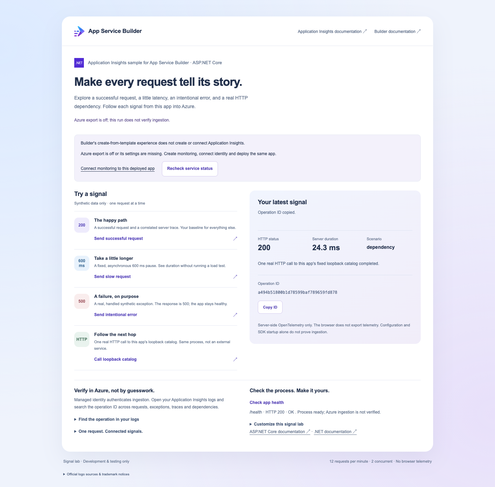

# Trace a request from App Service Builder into Application Insights

An ASP.NET Core/.NET 10 signal lab. Four bounded synthetic scenarios produce actual server-side HTTP traces; Application Insights export uses the app's system-assigned managed identity.

**Connect existing monitoring through Builder Connections.** The template wizard does not provision a component/workspace. Follow [setup](#setup) for your **already deployed app**, without creating a duplicate app. Configuration or UI counters are not proof of ingestion.

**Private Preview, development/test only.** Use approved Builder access and a supported .NET 10 target. Azure hosting and monitoring incur separate charges. Retained historical demo windows are expired; do not renew another owner's resources.

## Preview



This is the actual local UI, with export off—not a hosted ingestion receipt. Official .NET/Builder marks, ecosystem links, inline health, result notebook and customization remain. Synthetic HTTP results do not prove Azure delivery; no browser SDK exports telemetry.

## Setup

Use these Portal steps for the existing app, or [CLI and ordered ARM/Bicep setup](docs/connection-automation.md) for terminal configuration and a new source-less app.
Both require correlated ingestion verification, not only a saved routing value.

Start with your own fork deployed from root `builder.yaml`. Keep that app/source connection. You need Azure CLI/Bicep, resource-management permission in a dedicated monitoring group, role-assignment authority on the new component and separate operator query access.

1. **Create monitoring only.** Set your approved subscription, an existing dedicated service group and unique workspace/component names. From this sample root, review what-if and create:

   ```bash
   SUBSCRIPTION="<subscription-id>"
   RG="<dedicated-monitoring-group>"
   INSIGHTS="<new-component-name>"
   WORKSPACE="<new-workspace-name>"
   az login --tenant "<tenant-id>"
   az deployment group what-if --subscription "$SUBSCRIPTION" -g "$RG" \
     --template-file infra/main.bicep \
     --parameters workspaceName="$WORKSPACE" applicationInsightsName="$INSIGHTS"
   az deployment group create --subscription "$SUBSCRIPTION" -g "$RG" \
     --template-file infra/main.bicep \
     --parameters workspaceName="$WORKSPACE" applicationInsightsName="$INSIGHTS"
   INSIGHTS_ID=$(az resource show --subscription "$SUBSCRIPTION" -g "$RG" \
     -n "$INSIGHTS" --resource-type Microsoft.Insights/components --query id -o tsv)
   ```

   `infra/main.bicep` creates only a dedicated workspace and component in West US 2, with a small daily cap, 30-day retention, public ingestion and **local auth disabled**. Review [Monitor pricing](https://azure.microsoft.com/pricing/details/monitor/); a daily cap is not a hard spending guarantee. **Do not apply `infra/sample.bicep` to this app**: that separate template creates a new source-less Builder app and is not this journey.
2. **Enable this app's identity.** In Builder **Identity**, enable system-assigned identity and choose **Save and deploy**. Wait for success; copy its **principal ID**, not client ID. Grant just:

   ```bash
   az role assignment create --subscription "$SUBSCRIPTION" \
     --assignee-object-id "<app-system-identity-principal-id>" \
     --assignee-principal-type ServicePrincipal \
     --role "Monitoring Metrics Publisher" --scope "$INSIGHTS_ID"
   ```

   This component-scoped role authorizes ingestion, not workspace queries. Do not grant the app Owner/Contributor or subscription-wide access. Give your human operator **Log Analytics Reader** on the dedicated workspace if needed for Logs. Allow role propagation.
3. **Save a monitoring connection, then deploy.** In the existing app's **Connections**, add **Application Insights**, select the new component and the app's system-assigned **Managed identity**, then retain `APPLICATIONINSIGHTS_CONNECTION_STRING` as the connection-string mapping. It is routing metadata, not authentication. The server exporter still acquires its own Entra token; a browser SDK cannot use managed identity.

   Keep only these separate controls in **Variables**:

   | Variable | Value |
   |---|---|
   | `TELEMETRY_MODE` | `managed-identity` |
   | `SAMPLE_EXPIRES_AT` | Your own approved future UTC deadline, `yyyy-MM-ddTHH:mm:ssZ` |
   | `AZURE_CLIENT_ID` | Leave unset; code selects system identity |

   For a variables-based app, remove the old manual connection string without deploying, then save the exact Connections mapping and deploy the complete desired configuration once. Keep routing metadata out of Git, browser code, environment dumps, logs and screenshots. Wait in **Deployments** and confirm the new active version. Saving, a restart or a retained version does not apply the new connection. [connection.json](connection.json) is the complete object; replace component resource ID and routing string. The production catalog advertises Application Insights Connections; qualification of this revision's deployed, correlated ingestion remains pending. The [Connections guide](https://builder.appservice.azure.com/docs/guides/connect-to-services/) covers client availability and ETag-guarded ARM setup. The [CLI/ARM alternatives](docs/connection-automation.md) include the native CLI release prerequisite; its separate deployment command is:

   ```bash
   builder app deploy --name "<existing-app>" \
     --subscription "$SUBSCRIPTION" --resource-group "<app-group>" --rebuild
   ```

4. **Verify actual records.** Open the returned HTTPS runtime URL. Check `/health` inline (liveness only), run **Intentional error** and **Loopback dependency** once, and copy their operation IDs. A synthetic error must remain HTTP 500; the dependency must be a real loopback HTTP call. Then open **your workspace > Logs** and query:

   ```kusto
   let Operations = dynamic(["<error-operation-id>", "<dependency-operation-id>"]);
   union withsource=Signal AppRequests, AppExceptions, AppTraces, AppDependencies
   | where TimeGenerated > ago(30m) and OperationId in (Operations)
   | project TimeGenerated, Signal, OperationId, ParentId
   | order by TimeGenerated asc
   ```

   Allow a few minutes, then require the error's request/exception/trace and the dependency's correlated request/dependency rows. Do not conclude success from the UI, token counters or an SDK HTTP 200. `/ready` reports only recent ingestion transport acceptance, never your operation's delivery; `/api/setup` always says `ingestionVerified:false`. Required [Builder visitor sign-in](https://builder.appservice.azure.com/docs/guides/authentication/) remains separate from exporter identity and operator query permission.
5. **Clean up only what you created.** Remove this app's component-scoped publisher assignment and delete your dedicated component/workspace when finished. Delete the app only if disposable. Shared resources/groups, unrelated role assignments and another owner's test window are not cleanup targets. App deletion does not remove monitoring or stop its charges; workspace deletion/retention rules still apply.

## Recovery

Use the app's `./README.md#setup` link and **Recheck service status**. Recheck makes no provider call, provisions nothing and accepts no credentials.

| Sanitized state | Owner action |
|---|---|
| Missing/invalid configuration; export off | Complete steps 1–3; deploy the same app. The dashboard still boots, but export is disabled. |
| Identity failure | Check system identity and successful active deployment. |
| Ingestion denied (401/403) | Verify publisher role on this component, identity selection and service network/access rules. |
| Partial acceptance (206), usage limit, rejected export | Inspect sanitized SDK categories; review destination, caps/quota and service status. |
| Export warning or no response yet | Check network/identity/destination; run one synthetic request after setup, then query its ID. Raw SDK diagnostics are deliberately omitted. |
| Recently accepted export | Transport acceptance is not ingestion verification; check the specific operation in Logs. |
| Demo expired (410) | Stop; a new window needs the resource owner's approval and a new version, not just a restart. |

An intentional 500 remains a failure response even though it is useful test data. Exporter/identity errors cannot turn HTTP scenario counters into verified ingestion. Health stays independent; no anonymous instrumentation-key fallback is used.

## Local development

See [local tests, browser checks, privacy and troubleshooting](docs/development.md). Existing focused commands:

```bash
dotnet test tests/Sample.Tests.csproj --no-restore --verbosity minimal
dotnet publish BuilderApplicationInsightsSample.csproj --no-restore -c Release -o bin/sample-publish
```

The root manifest retains .NET 10, port 8080 and `/health` as liveness. Customize `wwwroot/` in your own fork, test and explicitly redeploy intended source; the page cannot discover/edit your fork.

## References

- [Builder Application Insights guide](https://builder.appservice.azure.com/docs/tutorials/application-insights/).
- [Azure Monitor OpenTelemetry](https://learn.microsoft.com/azure/azure-monitor/app/opentelemetry-enable).
- [Application Insights Entra authentication](https://learn.microsoft.com/azure/azure-monitor/app/azure-ad-authentication).
- [Official .NET brand sources](https://github.com/dotnet/brand); local unmodified artwork/license in `wwwroot/assets/`. Builder's supplied mark is retained; trademarks belong to their owners.
- [Contributing](CONTRIBUTING.md), [license](LICENSE.md), [security reporting](SECURITY.md).
